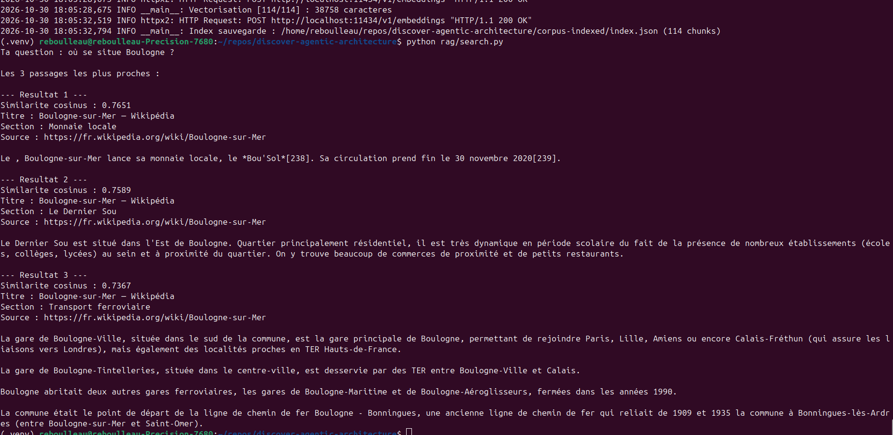

# RAG (Retrieval-Augmented Generation)

Based on this documentation: https://www.stephane-robert.info/docs/developper/programmation/python/rag-introduction/

<!-- TOC -->
* [RAG (Retrieval-Augmented Generation)](#rag-retrieval-augmented-generation)
  * [Collect and clean the content](#collect-and-clean-the-content)
  * [Clean the text](#clean-the-text)
  * [Chunk and index the text](#chunk-and-index-the-text)
  * [Semantic chunking](#semantic-chunking)
  * [Embedding (transform text into vectors)](#embedding-transform-text-into-vectors)
    * [Install nomic-embed-text model with Ollama](#install-nomic-embed-text-model-with-ollama)
    * [Build the vector index](#build-the-vector-index)
    * [Similarity](#similarity)
    * [Search](#search)
  * [FAISS](#faiss)
  * [Chroma](#chroma)
  * [Qdrant](#qdrant)
  * [pgvector](#pgvector)
<!-- TOC -->

## Collect and clean the content

**Trafilatura** is an open-source Python package and command-line tool designed to crawl web pages, extract main text content, and strip away boilerplate noise like ads, navigation bars, and footers.

Install:
```shell
python3 -m venv .venv
source .venv/bin/activate
python -m pip install trafilatura==2.0.0 lxml-html-clean==0.4.5
```

Create script to extract content from web pages: `extract-html-content-for-rag.py`

Execute it
```shell
python extract-html-content-for-rag.py
```

Corpus is created in `corpus/doc_000.json`

## Clean the text

Clean invisible characters, repeated spaces, residual HTML, and inconsistent Unicode encoding.

Create script to clean the text: `python clean-text-for-rag.py`

**We use a custom script in this project, but for true project, use a professional tool like spaCy or NLTK**

## Chunk and index the text

The key to RAG is to create a searchable index of the text: not too small, not too large to keep the expected context.

The concept is to:
- split the text into chunks
- and overlap between chunks
  - ex: split text from 1 to 50 characters, and then split from index 40 to 90.
  - so 2 chunks index a same part of characters.

We can split by sentences or paragraphs.

```shell
python chunk.py
```

## Semantic chunking

Recommended if the text is not split by section, like a prose. 

## Embedding (transform text into vectors)

**Important**: we must use the same model to embedding the content and the question of the user to have the same vectors.

### Install nomic-embed-text model with Ollama

Ollama is a soft to download and execute AI models locally.

`nomic-embed-text` is a model of embedding with 137 million parameters.

```shell
curl -fsSL https://ollama.com/install.sh | sh
ollama pull nomic-embed-text
ollama serve
```

### Build the vector index

With the virtual environment activated and Ollama running:

```shell
python -m pip install openai
python embedding.py
```

The script reads all JSON files in `corpus-chunks/` and saves the index to
`corpus-indexed/index.json`. Each entry keeps the original chunk text and metadata
and adds a `vecteur` field for similarity search.

### Similarity

The standard measure is the **cosinus similarity**. 

The result can be:
* -1 opposite
* 0 no match
* 1 100% similar

### Search

Execute the script `search.py`. It vectorizes the question and searches the index with the cosinus similarity.



**Attention**: this implementation is not scalable, because we search vector by vector.
We need to use index as FAISS, Qdrant, etc.

## FAISS

FAISS is a library for efficient similarity search and clustering of dense vectors in memory only.
FAISS is a libray of META.

```shell
pip install faiss-cpu
python search-with-faiss.py
```

## Chroma

More complete than FAISS, Chroma is a embedded vector database that provides persistence, filter and metadata management.
But, it is not distributed.

## Qdrant

Qdrant is a distributed vector database that provides persistence, filter and metadata management.
It is developed in Rust.

I don't POC this step, I favor to focus on pgvector.

## pgvector

Run Docker
```shell
docker run -d -e POSTGRES_PASSWORD=lab -e POSTGRES_DB=ragdb -p 5435:5432 pgvector/pgvector:pg17
```

```shell
python -m pip install psycopg
python pg-vector.py
```

**Attention: the `::vector` cast in the SQL query is mandatory.**

| Project stage                                                 | Vector database |
|---------------------------------------------------------------|-----------------|
| Prototype, in-memory corpus                                   | FAISS           |
| Development, metadata, persistence                            | Chroma          |
| Production, shared service, scaling with high volume          | Qdrant          |
| Production, shared service, scaling with existing PostgresSQL | pgvector        |

## SpringBoot and pgvector

See `ragdemo` project in `./ragdemo` folder, and read [Readme.md](ragdemo/Readme.md).

